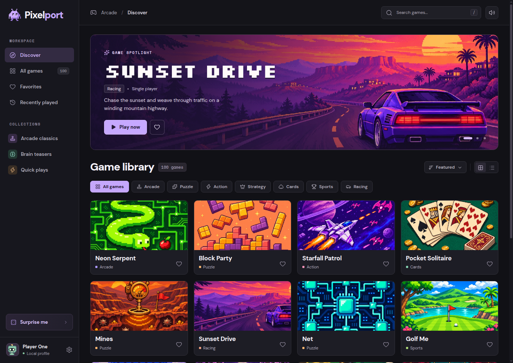
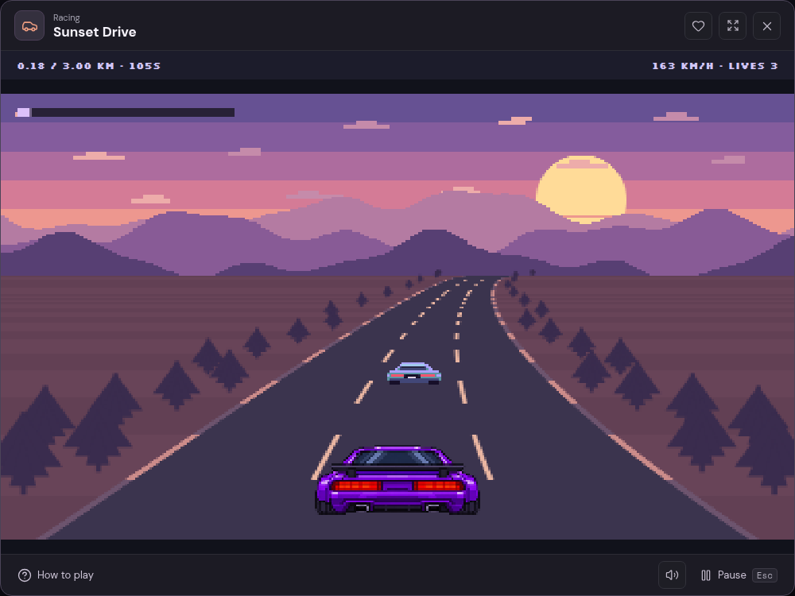
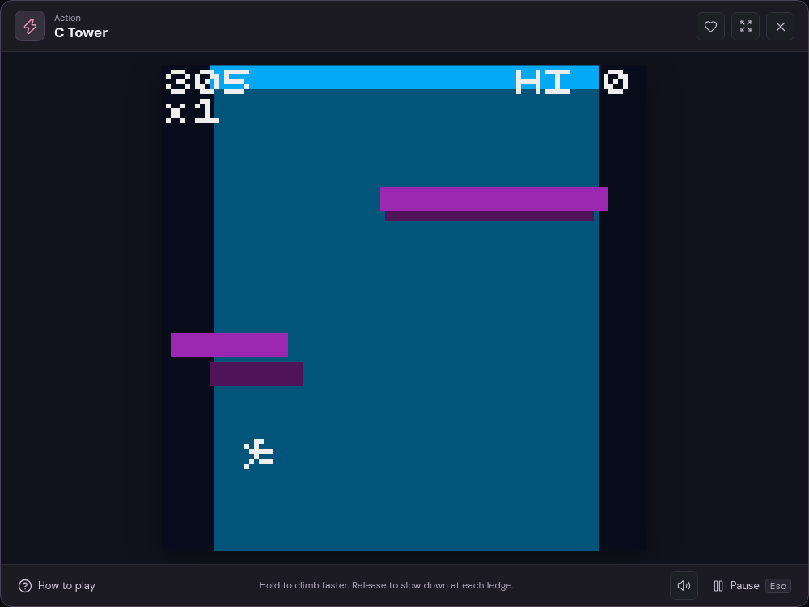
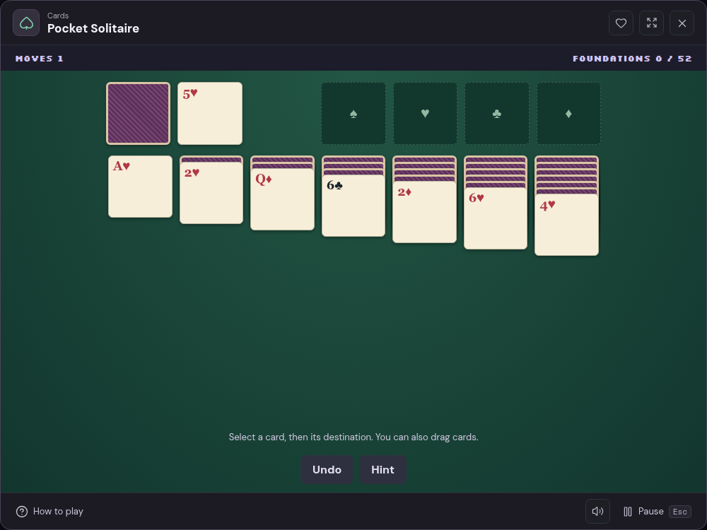
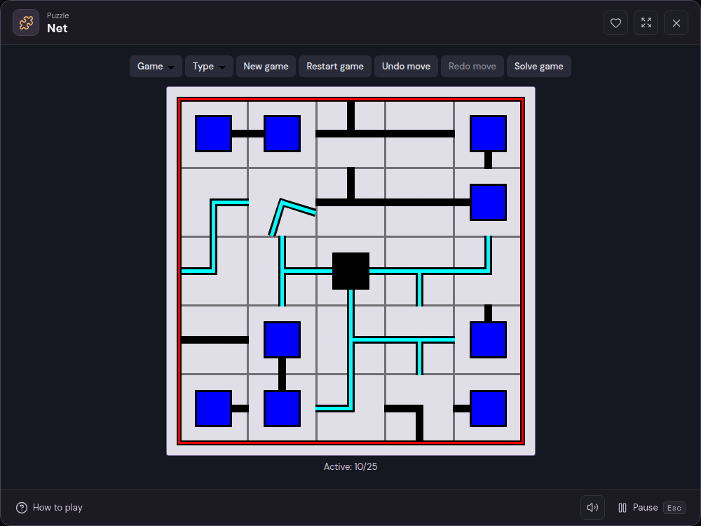

# Pixelport

**100 offline games in one desktop arcade.** Weave through traffic in Sunset Drive, play a hand of Klondike, or turn a tangle of wires into a working network. Every game, cover, font, and sound ships with the app. Once installed, you can play the whole library offline.

**[Download Pixelport for Linux x64 (.deb)](https://github.com/VincentAZ/Pixelport/releases/download/v1.0.1/pixelport_1.0.1_amd64.deb)** · [Release notes](https://github.com/VincentAZ/Pixelport/releases/tag/v1.0.1) · [Run from source](#run-from-source)



## Pick a game

| Collection | Games | Try these first |
| --- | ---: | --- |
| Pixelport originals | 10 | Race the three-kilometre highway in **Sunset Drive**, chase apples in **Neon Serpent**, or deal a round of **Pocket Solitaire**. |
| Kenta Cho / ABA Games | 50 | Hold to climb the rotating **C Tower**, aim a jump in **Golf Me**, or charge a shot in **Charge Beam**. |
| Simon Tatham’s Portable Puzzle Collection | 40 | Rotate wires in **Net**, connect islands in **Bridges**, or deduce the safe squares in **Mines**. |

The library also groups games by genre. Choose **All games → Arcade** for the 17 Arcade-tagged titles. **Arcade classics** in the sidebar is a 12-game selection that includes card and board games. Press `/` to search by title or genre, or choose **Surprise me** to jump straight into a game.

## At the controls

| Sunset Drive | C Tower |
| --- | --- |
|  |  |
| Steer with the arrow keys. Reach the finish before the clock runs out. | Hold to climb faster. Release to slow down as a ledge comes around. |

| Pocket Solitaire | Net |
| --- | --- |
|  |  |
| Select a card or run, then its destination. Undo a move or ask for a hint. | Rotate the tiles until every terminal connects to the power source. |

Open **How to play** inside any game for its controls. Press `Esc` to pause. Returning to the library suspends the current game until you switch games or quit. Puzzle boards and original table games also resume after restarting Pixelport. Favorites, play history, sound settings, and arcade personal bests stay in your local profile.

## Install on Linux

Open the downloaded Debian package in your software installer, then launch **Pixelport** from the applications menu. On Debian or Ubuntu you can also run this from the folder containing the download.

```sh
sudo apt install ./pixelport_1.0.1_amd64.deb
```

## Run from source

Use Node.js **22.12 or newer** and npm. The first installation downloads Electron.

```sh
git clone https://github.com/VincentAZ/Pixelport.git
cd Pixelport
npm ci
npm start
```

For a local browser preview, run `npm run dev` and open [localhost:5173](http://localhost:5173).

| Command | What it does |
| --- | --- |
| `npm test` | Launches all 100 games in Electron using a temporary profile. Checks gameplay input, library navigation, saved progress after restart, and offline operation. |
| `xvfb-run -a npm test` | Runs the same suite on a headless Linux machine. |
| `npm run package` | Builds the desktop bundle in `dist/`. On Linux it also builds a Debian installer and requires `dpkg-deb`. |

Linux x64 is the tested desktop target. Set `PIXELPORT_EXECUTABLE` to the path of a packaged binary to run the suite against that build.

## Credits

Kenta Cho made the 50 ABA Games titles and the engine that runs them. Simon Tatham and contributors made the 40 portable puzzles. [ABA Games source](https://github.com/abagames/crisp-game-lib-games/tree/cfb39d2f988feb5918eb83697145b5a35adabf58) · [crisp-game-lib](https://github.com/abagames/crisp-game-lib) · [Portable Puzzle Collection](https://www.chiark.greenend.org.uk/~sgtatham/puzzles/)

Third-party notices are included in the app under **Player settings → Game credits & licenses**. The illustrated covers and their generation prompts are included in the repository. [Third-party notices](app/licenses/) · [Cover artwork and prompts](app/assets/covers/)
